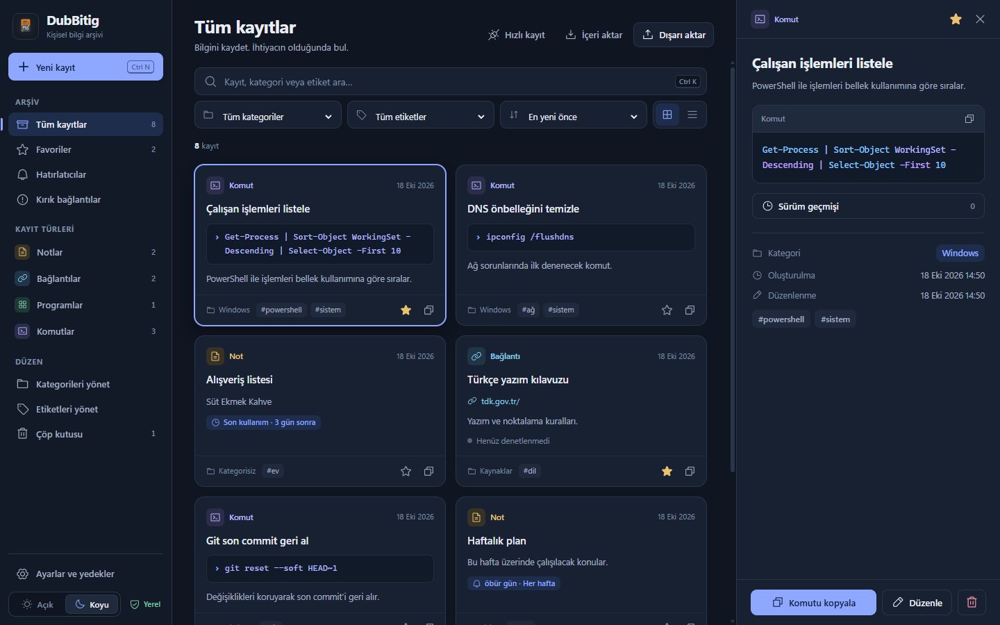
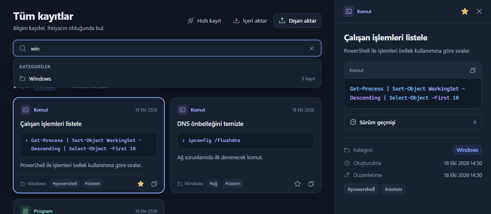
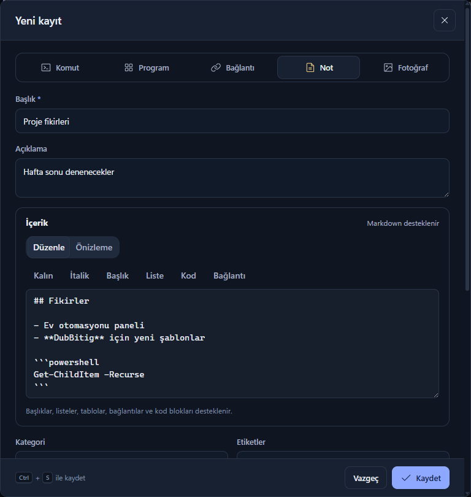
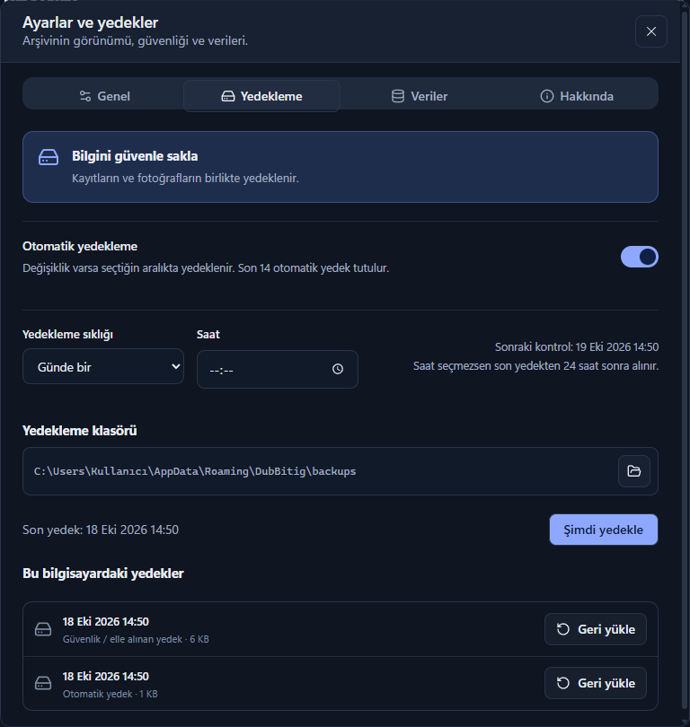
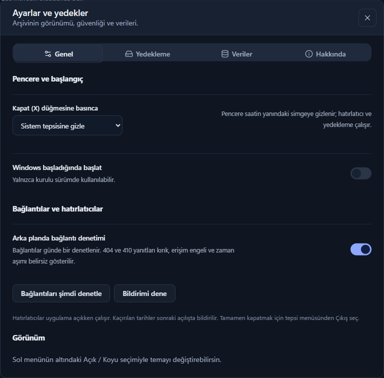
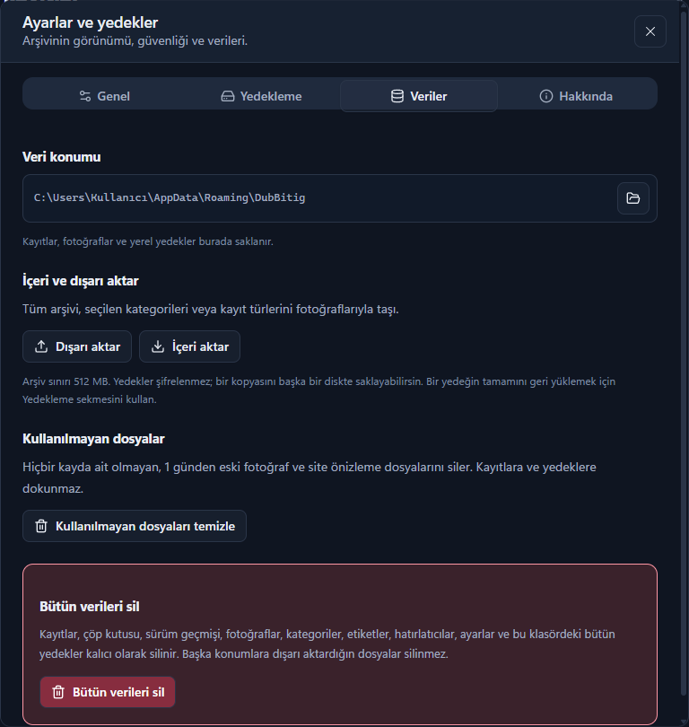
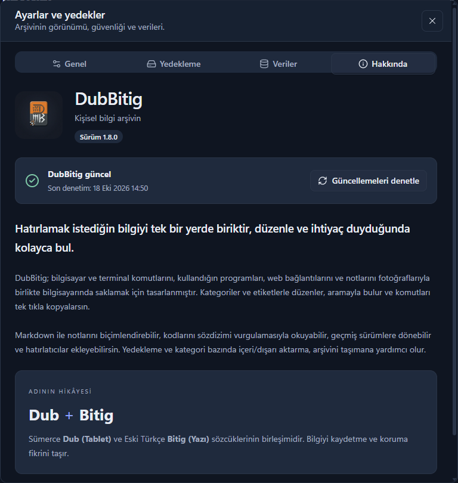

# DubBitig 1.10

Not, bağlantı, program ve komutlar için fotoğraf ekli Türkçe kişisel arşiv. Windows ve Linux'ta çalışır; Chrome ve Firefox eklentisiyle hızlı kayıt alır. DubBitig adı Sümerce Dub (Tablet) + Eski Türkçe Bitig (Yazı) birleşimidir.

**[Windows Setup / Linux AppImage indir](https://github.com/Nergal-exe/DubBitig/releases/latest)** · [Tüm sürümler ve tarayıcı eklentileri](https://github.com/Nergal-exe/DubBitig/releases) · [Hata bildir](https://github.com/Nergal-exe/DubBitig/issues)

**Lisans:** [GNU General Public License v3.0 (GPLv3)](LICENSE.txt)

## Ekran görüntüleri

### Ana ekran

Bölümlere ayrılmış sol menü, sabit arama ve filtre çubuğu, kayıt kartları ve bağlama göre eylem sunan ayrıntı paneli.



### Genel arama

Arama kutusu yazarken kayıtların yanında eşleşen kategori ve etiketleri de önerir; seçilen kategori veya etiket filtre olarak uygulanır.



### Yeni kayıt ve Markdown düzenleyici

Not, bağlantı, program veya komut kaydı oluşturma; fotoğraf ekleme, Markdown biçimlendirme, önizleme ve hızlı hatırlatma seçenekleri. Pencereler bağımsızdır: kayıt düzenlerken ana pencereyi kullanmaya devam edebilir, pencereleri başlığından sürükleyebilirsiniz.



### Yedekleme

Otomatik yedekleme aralığı ve günlük yedek saati, yedek klasörünün konumu, elle yedek alma ve mevcut yedekleri geri yükleme.



### Genel ayarlar

Kapat düğmesinin davranışı (tepsiye gizle, simge durumuna küçült veya çık), Windows açılışında başlatma, bağlantı denetimi ve bildirim testi.



### Veri yönetimi

Veri klasörüne erişim, içeri/dışarı aktarma, kullanılmayan dosyaları temizleme ve bütün verileri silme seçenekleri.



### Hakkında ve güncellemeler

GitHub'da yeni sürüm yayımlandığında Hakkında sekmesinde, Ayarlar düğmesinde ve bir kez Windows bildiriminde gösterilir; indirme sayfası tek tıkla açılır.



## Kurulum ve veri konumu

`release-dubbitig/DubBitig-1.10.0-Setup.exe` dosyasını çalıştırın. Kurulum yönetici izni ister; varsayılan uygulama konumu `C:\Program Files\DubBitig` olur. Eski sürümü kurulumdan önce kapatın. Setup önceki kullanıcı kurulumunu yükseltir; arşivi silmez. `DubBitig-Baslat.cmd` önce Program Files içindeki sürümü açar.

Veriler kullanıcıya özel `%APPDATA%\DubBitig` klasöründedir. Önceki `%APPDATA%\sakli` arşivi ilk açılışta fotoğrafları, ayarları ve yedekleriyle taşınır. Yeni konumda arşiv varsa üzerine yazılmaz. Chrome önceden yeni gelen kutusu oluşturduysa aşamalı taşıma yapılır; kesilen işlem sonraki açılışta tamamlanır. Çakışmada veriler korunarak hata gösterilir.

- `sakli.sqlite`: kayıtlar, kategoriler, etiketler, geçmiş ve ayarlar. Eski yedek uyumluluğu için veritabanı ve `.sakli` uzantısı korunur.
- `photos/`: yerel fotoğraflar ve web önizlemeleri.
- `backups/`: tam arşiv yedekleri.
- `capture-inbox/`: Chrome aktarım istekleri ve makbuzları.

Ayarlar → Veriler bölümünde gerçek konumu görebilir, klasörü açabilir ve **Veri konumunu değiştir** ile arşivi başka bir klasöre taşıyabilirsiniz (aşağıya bakın). Uygulamayı kaldırmak arşivi silmez.

Varsayılan klasörde ayrıca `data-location.json` (seçilen veri konumu; her işletim sistemi kendi kopyasını tutar) ve Electron'un önbellek dosyaları bulunur. Veri klasöründeki `dubbitig.lock`, klasörü o anda hangi DubBitig'in kullandığını gösterir.

## Veri konumunu değiştirme ve Windows/Linux ortak klasörü

Windows ile Linux'u aynı bilgisayarda (dual-boot) kullanıyorsanız arşivi iki sistemin de eriştiği bir NTFS klasörüne koyabilirsiniz. İnternet, bulut veya senkronizasyon servisi gerekmez: iki sistem aynı fiziksel klasörü sırayla kullanır. Aynı anda iki bilgisayardan ya da iki sistemden düzenleme desteklenmez.

### Ne zaman güvenli?

- Aynı anda yalnızca **bir** DubBitig açık olmalı. Diğer sisteme geçmeden önce DubBitig'i tepsi menüsünden **Çıkış** ile kapatın.
- Windows **tamamen kapatılmış** olmalı: Hızlı Başlatma kapalı olmalı, hazırda bekletme kullanılmamalı (ayrıntılar aşağıda).
- Linux'ta NTFS bölümü **yazılabilir** bağlı olmalı.
- Klasörü OneDrive, Dropbox, Google Drive gibi senkronizasyon klasörlerine koymayın; bu araçlar dosyayı arka planda değiştirebilir.
- İki sistemde de **aynı DubBitig sürümünü** kullanın. Eski bir sürüm, yeni sürümde eklenen kayıt türlerini (ör. 1.10'daki Dizi/Film ve Kitap) tanımaz; 1.9.x bu kayıtları görünce arayüz açılmayabilir.

DubBitig veritabanını bellekte tutar ve her değişiklikte `sakli.sqlite` dosyasını geçici dosya + `fsync` + yeniden adlandırma ile baştan yazar; SQLite'ın kendi dosya kilitleri kullanılmaz. Bu yüzden iki DubBitig aynı dosyayı birlikte yazarsa son yazan diğerinin değişikliklerini silebilir. Bunu önlemek için:

- Açılışta veri klasöründe başka bir sistemin kilidi (`dubbitig.lock`) varsa uyarı gösterilir ve devam etmek için onay istenir.
- Dosya bu DubBitig'in son yazdığı hâlden farklıysa (ör. hazırda bekletmeden dönen Windows'taki eski oturum) üzerine **yazılmaz**; uygulamayı yeniden başlatmanız istenir.
- Dosya kaybolursa (bölüm ayrıldıysa) kayıt yapılmaz.

NTFS üzerinde yeniden adlandırma ve `fsync` davranışı sürücüye göre değişir (Linux'ta `ntfs3` veya `ntfs-3g`). Bu sürümde ortak NTFS kullanımı gerçek bir dual-boot kurulumunda sınanmamıştır; yedeklerinizi ayrıca başka bir diske de alın.

### 1. Ortak NTFS klasörü oluşturma

Windows'ta iki sistemin de gördüğü bir NTFS bölümünde (C: dışında bir veri bölümü önerilir, ör. `D:`) `D:\DubBitigData` gibi boş bir klasör oluşturun. Linux'ta bu bölüm genellikle `/run/media/<kullanıcı>/<bölüm adı>` veya `/mnt/<ad>` altında görünür.

### 2. Windows'ta veri konumunu değiştirme

1. Ayarlar → Veriler → **Veri konumunu değiştir**.
2. `D:\DubBitigData` klasörünü seçin. Klasör dolu ve DubBitig verisi değilse içinde `DubBitig` alt klasörü oluşturulur; diğer dosyalarınıza dokunulmaz.
3. Özette taşınacak veriler, gereken ve boş alan gösterilir. **Kopyala ve geç** seçin.
4. DubBitig önce güvenlik yedeği alır, yazmaları durdurur, her şeyi hedefteki gizli `.dubbitig-hazirlik-…` klasörüne kopyalar, her dosyayı boyut ve SHA-256 ile, veritabanını SQLite bütünlük denetimiyle doğrular. Ancak bundan sonra dosyalar yerine taşınır ve yeni konum kaydedilir.
5. DubBitig yeniden başlar ve yeni klasörü kullanır. Eski klasör silinmez.

Kopyalanan: `sakli.sqlite` (kayıtlar, kategoriler, etiketler, geçmiş, ayarlar), `photos/`, `backups/`, `capture-inbox/`. Fotoğraflar veritabanında yalnızca kimlikleriyle tutulur (mutlak yol yoktur), bu yüzden taşımadan sonra ve diğer sistemde de aynı kayıtlara bağlı kalır. Kaynakta zaten eksik olan fotoğraflar raporlanır; başka bir dosyaya bağlanmaz.

### 3. Linux'ta aynı fiziksel klasörü seçme

1. Windows'ta DubBitig'i kapatın ve Windows'u tamamen kapatın.
2. Linux'ta NTFS bölümünü yazılabilir bağlayın (aşağıda).
3. DubBitig → Ayarlar → Veriler → **Veri konumunu değiştir** → aynı klasörü (ör. `/run/media/kullanici/Veri/DubBitigData`) seçin.
4. Klasörde arşiv bulunduğu için kopyalama yapılmaz; iki seçenek sunulur:
   - **Bu arşivi kullan:** Linux'taki DubBitig ortak arşivle açılır. Linux'taki eski arşiv olduğu yerde (`~/.config/DubBitig`) kalır.
   - **Kayıtlarımı ekleyip kullan:** Linux'ta daha önce kaydettikleriniz fotoğraflarıyla ortak arşive eklenir (önce ortak arşivin güvenlik yedeği alınır; aynı kayıtta daha yeni olan tutulur, çakışan sürümler kopya olarak eklenir).
5. DubBitig yeniden başlar. Artık iki sistemde eklenen kayıtlar aynı klasörde birikir.

### Linux'ta NTFS bölümünü yazılabilir bağlama

Dosya yöneticisinde bölüme tıklamak çoğu masaüstünde onu `/run/media/<kullanıcı>/…` altına yazılabilir bağlar. Her açılışta aynı yolda olması için `/etc/fstab` örneği (UUID'yi `lsblk -f` ile bulun):

```
UUID=XXXXXXXXXXXXXXXX  /mnt/veri  ntfs3  uid=1000,gid=1000,windows_names,nofail  0  0
```

`ntfs3` yoksa sürücü olarak `ntfs-3g` kullanılabilir. DubBitig bölümü kendisi bağlamaz, biçimlendirmez ve sistem ayarlarını değiştirmez; yalnızca klasöre yazılabildiğini sınar.

### Windows Hızlı Başlatma ve hazırda bekletme uyarısı

Hızlı Başlatma açıkken veya Windows hazırda bekletmedeyken NTFS bölümü "kullanımda" bırakılır. Linux bölümü bağlamayı reddeder ya da yalnızca okunabilir bağlar; zorla yazmak veri kaybına yol açabilir. DubBitig bu durumda klasörü "yazılamıyor" diye bildirir.

- Denetim Masası → Güç Seçenekleri → Güç düğmelerinin yapacaklarını seçin → **Hızlı başlatmayı aç** kutusunu kaldırın.
- Linux'a geçerken **Yeniden başlat** veya (Hızlı Başlatma kapalıyken) **Kapat** kullanın; hazırda bekletmeyin.
- Hazırda bekleyen Windows'ta açık kalmış DubBitig, Windows'a dönüldüğünde Linux'taki değişikliklerin üzerine yazmaya çalışırsa yazma reddedilir; DubBitig'i yeniden başlatın.

### Yedek alma ve eski konuma dönme

- Taşımadan önce otomatik olarak `before-relocation` güvenlik yedeği alınır. Ayrıca **Dışarı aktar** ile başka bir diske tam yedek almanız önerilir.
- Eski klasör kendiliğinden silinmez. Ayarlar → Veriler'deki **Eski kopyayı temizle**, onayınızdan sonra yalnızca DubBitig veri dosyalarını sistemin çöp kutusuna taşır.
- Eski konuma dönmek için **Veri konumunu değiştir** ile eski klasörü seçip **Bu arşivi kullan** deyin. Varsayılan konum Windows'ta `%APPDATA%\DubBitig`, Linux'ta `~/.config/DubBitig` klasörüdür. Eski klasör taşıma anındaki hâlindedir; sonraki kayıtları almak için **Kayıtlarımı ekleyip kullan** seçin.

### Veri klasörü erişilemiyorsa kurtarma

Seçilen klasör bulunamaz, boşsa (bağlanmamış bağlama noktası), okunamaz veya yazılamazsa DubBitig **boş arşiv oluşturmaz**; açılışta şu seçenekleri sunar:

- **Yeniden dene:** Bölümü bağladıktan sonra.
- **Başka klasör seç:** Arşivin (`sakli.sqlite`) bulunduğu klasörü gösterin; bütünlüğü denetlenip kullanılır.
- **Varsayılan konumu kullan:** Varsayılan klasördeki (daha eski olabilecek) arşivle açılır. Ortak klasör geri geldiğinde Ayarlar'dan yeniden seçin.
- **Çık.**

Taşıma sırasında uygulama kapanır veya elektrik kesilirse, yeni konum kaydedilmediği sürece eski klasör kullanılmaya devam eder; sonraki açılışta işlem günlüğüne (`data-location-journal.json`) bakılarak hedefteki yarım kopya kaldırılır. Elle kurtarma gerekirse: DubBitig'i kapatın, varsayılan klasördeki `data-location.json` dosyasını silin (DubBitig varsayılan konumu kullanır) veya içindeki `path` değerini arşivin bulunduğu klasörle değiştirin.

## Kullanım

- Yeni kayıt: **Ctrl+N**. Arama: **Ctrl+K** veya **/**. Kayıt formunda kaydetme: **Ctrl+S**. Ayrıntı panelini kapatma: **Esc**. Başlık, içerik, açıklama, bağlantı, kategori, etiket ve fotoğraf adı aranır; OCR yoktur.
- Notlarda Markdown başlıkları, kalın/italik, listeler, tablolar, bağlantılar ve kod blokları kullanılır. Düzenle / Önizleme sekmeleri bulunur. HTML çalıştırılmaz; harici Markdown görselleri otomatik indirilmez, fotoğraf olarak eklenebilir.
- Komutlarda otomatik veya seçili dilde sözdizimi vurgulaması vardır. PowerShell, Bash, CMD, JavaScript, TypeScript, Python, JSON, SQL, YAML, HTML/XML, CSS ve C# desteklenir. Komutlar çalıştırılmaz; özgün metin tek tıkla kopyalanır.
- Kategoriler sol menüde listelenmez; **Kategorileri yönet** içinden yönetilir. Arama çubuğunun yanındaki kategori ve etiket filtreleri aramayla birlikte kullanılabilir; etkin filtreler tek tek kaldırılabilir. Kategori/etiket kaldırmak kayıtları silmez.
- **Dizi/Film** ve **Kitap** türleri izleme ve okuma listesi içindir: yalnızca ad, açıklama, isteğe bağlı bağlantı (ör. IMDb, Goodreads) ve etiketler tutulur; kategori, içerik, fotoğraf ve hatırlatıcı yoktur. Aynı bağlantı aynı türde iki kez kaydedilemez.
- Ayrıntı panelinde kayıt türüne göre ana eylem bulunur: komutta **Komutu kopyala**, bağlantıda ve bağlantısı olan dizi/film ve kitapta **Bağlantıyı aç**. Kart/liste görünümü tercihi hatırlanır.
- Açık/koyu tema sol alttan seçilir. Arayüz React, Tailwind CSS ve shadcn/ui bileşenleri kullanır.
- Saatin yanındaki simge: aç, pencereyi gizle, panodakini kaydet, çıkış. Gizlenen pencerenin hatırlatıcıları çalışmaya devam eder. Pencerenin X düğmesi uygulamayı kapatmaz, sistem tepsisine gizler. Tamamen kapatmak için simgeye sağ tıklayıp Çıkış seçin. Uygulamayı yeniden açmak mevcut pencereyi gösterir. Windows açılışında otomatik başlatma etkin değildir.
- **Hakkında** sekmesinde sürüm, güncelleme durumu, uygulamanın amacı ve adının anlamı bulunur. Yeni sürüm varsa **Güncellemeyi indir ve kur** ile kurulum biçimine uygun dosya (Setup.exe, AppImage, .deb veya .pacman) GitHub'dan indirilir, GitHub'ın yayımladığı boyut ve SHA-256 özetiyle doğrulanır, kurulur ve DubBitig yeniden açılır. Windows'ta kurulum arka planda çalışır ve yönetici izni ister; .deb/.pacman kurulumlarında parola penceresi (`pkexec`) açılır; AppImage dosyası yerinde değiştirilir. Taşınabilir (portable) sürüm ve geliştirme kopyası indirme sayfasını açar. Bu düğme 1.10.0 ile geldi; 1.9.x'ten 1.10.0'a geçiş bir kez elle yapılır.
- Fotoğraflar not, bağlantı, program ve komut kayıtlarına eklenir (PNG/JPEG/WebP/GIF; fotoğraf başına 20 MB, kayıt başına 30 fotoğraf). Ayrı “Fotoğraf” kayıt türü 1.8 ile kaldırıldı; eski fotoğraf kayıtları fotoğraflarıyla birlikte nota dönüştürülür.
- Aynı başlık, aynı bağlantı, aynı program web sitesi ve aynı komut ikinci kez kaydedilemez; form yazarken uyarır. Tarayıcıdan veya panodan gelen aynı içerik mevcut kaydı gösterir.
- Bağlantı yazarken `https://` gerekmez; `ornek.com` gibi adreslerin başına otomatik eklenir.
- Kategori ve etiket alanları ile arama kutusu yazarken öneri sunar (ok tuşları ve Enter ile seçilir).

## Yedekleme ve silme

Ayarlar → Yedekleme: 30 dakika, günlük, haftalık veya aylık aralık seçilebilir. Günlük yedekte saat de seçilebilir; yedek o saatten sonraki ilk kontrolde alınır. Yedek klasörünün konumu aynı sekmede görünür. Değişiklik varsa yedek alınır; uygulama kapalıyken kaçırılan kontrol sonraki açılışta yapılır. Son 14 otomatik yedek tutulur; elle alınanlar korunur.

Dışa aktarmada Tümünü dışa aktar, Kategorileri dışa aktar ve Kayıt türlerini dışa aktar seçenekleri vardır. Tek bir kategori/tür seçerek ayrı dosyaya, birden fazla seçerek tek dosyaya aktarabilirsiniz. Kayıt türleri: komut, program, bağlantı, not, dizi/film, kitap (eski arşivlerde fotoğraf). Kategori/tür aktarımları yalnızca aktif kayıtları ve bunlara ait fotoğrafları/geçmişi içerir. İçeri aktarma bu dosyaları özgün kategori ve türlerini koruyarak birleştirir. İstenirse Hedef kategoriye yeni kopyalar ekle kullanılabilir. Tam arşiv çöp kutusu ve geçmişi de içerir. Tek kategoriye içe aktarma yeni kopyalar oluşturur. Kategori veya kayıt türü dosyası bütün arşivin yerine geri yüklenemez. Tam geri yükleme önce güvenlik yedeği alır. `.sakli` ZIP arşiv sınırı 512 MB; yedekler şifrelenmez. Başka diske kopyalamak disk arızasına karşı koruma sağlar.

Silinen kayıtlar önce **Çöp kutusu**na taşınır. Çöp kutusunda **Çöp kutusunu boşalt** ile tümü, kayıt ayrıntılarındaki kalıcı silme düğmesiyle tek kayıt kalıcı olarak silinir; yalnızca bu kayıtlara ait fotoğraflar da diskten kaldırılır. Daha önce alınmış yedeklerdeki kopyalar korunur. Hiçbir kayda ait olmayan, 1 günden eski fotoğraf ve önizleme dosyaları her açılışta ve **Ayarlar → Veriler → Kullanılmayan dosyaları temizle** ile silinir.

**Ayarlar → Veriler → Bütün verileri sil**, `BÜTÜN VERİLERİ SİL` yazılı onayıyla kayıtları, çöp kutusunu, geçmişi, kategorileri, etiketleri, hatırlatıcıları, fotoğrafları, ayarları ve veri klasöründeki yerel yedekleri kalıcı olarak temizler. Veritabanı boş sayfalardaki eski içeriği bırakmadan yeniden oluşturulur. Başka konuma dışarı aktarılan dosyalar ve kaynak fotoğraflar silinmez. Silme sırasında devam eden web önizlemeleri arşivi yeniden dolduramaz.

## Bağlantılar, geçmiş ve hatırlatıcılar

HTTP/HTTPS bağlantılarında başlık, açıklama, favicon ve varsa önizleme alınır. Oturum/JavaScript gerektiren veya erişimi engelleyen sitelerde elle bilgi girilebilir. Günlük arka plan denetimi 404/410 yanıtlarını kırık, zaman aşımı/403/5xx yanıtlarını belirsiz gösterir. Denetim Genel sekmesinden kapatılabilir.

Not/komutların son 50 içerik sürümü saklanır. Geçmişi geri yüklemek güncel içeriği de geçmişe kaydeder. Tarihli hatırlatıcılar bir kez/günlük/haftalık/aylık çalışır. Son kullanma tarihi kayıt silmez; bildirim üretir. Uygulama kapalıyken kaçırılan bildirimler sonraki açılışta gösterilir ve Hatırlatıcılar bölümünde saklanır.

## Windows, Chrome ve Firefox

Setup Windows masaüstü/Dosya Gezgini sağ tık menülerini ve Chrome native-messaging bağlantısını kurar. Windows 11'de Daha fazla seçenek altında görünebilir. Başka uygulamalarda kopyaladıktan sonra **Ctrl+Alt+D** ile kaydedin. Dosyalar üzerindeki menü metin/komut içeriğini, fotoğrafları veya diğer dosyaların konumunu alır; çalıştırmaz.

Chrome eklentisi henüz Chrome Web Store'da yayımlanmamıştır. İlk kurulumda uygulamadaki Windows ve Chrome bölümünden eklenti klasörünü açın; `chrome://extensions` → Geliştirici modu → Paketlenmemiş öğe yükle ile ekleyin. Kaynak klasörden yüklediyseniz yeni sürüm için Yeniden yükle düğmesine basın. Seçili metin veya bağlantı sağ tıkla kaydedilebilir; uygulama kapalıysa açılır. Ayrıntılar `chrome-extension/README.md` içindedir.

Firefox eklentisi aynı özellikleri sunar ve `firefox-extension` klasöründedir (sürüm sayfasında `DubBitig-Firefox-x.y.z.zip`). Setup Firefox yerel bağlantısını da kaydeder. Geçici kurulum: `about:debugging#/runtime/this-firefox` → Geçici eklenti yükle → `manifest.json`. Firefox kararlı sürümünde kalıcı kurulum için eklentinin Mozilla tarafından imzalanması gerekir; ayrıntılar `firefox-extension/README.md` içindedir.

## Linux

Linux paketleri GitHub Actions ile Ubuntu üzerinde derlenir (`.github/workflows/linux.yml`) ve [sürüm sayfasına](https://github.com/Nergal-exe/DubBitig/releases/latest) eklenir. Yalnızca 64 bit (x86_64) desteklenir.

### Kurulum

**AppImage (bütün dağıtımlar, kurulum gerektirmez)**

```bash
chmod +x DubBitig-1.10.0-x86_64.AppImage
./DubBitig-1.10.0-x86_64.AppImage
```

AppImage açılmazsa FUSE eksiktir: Ubuntu 22.04 ve sonrasında `sudo apt install libfuse2`, Fedora'da `sudo dnf install fuse-libs`. Uygulama menüsüne eklemek için AppImageLauncher veya Gear Lever kullanılabilir. Güncellemek için Ayarlar → Hakkında → **Güncellemeyi indir ve kur** kullanın (AppImage dosyasının bulunduğu klasör yazılabilir olmalı) ya da yeni `.AppImage` dosyasını eskisinin yerine koyun.

**Debian / Ubuntu / Linux Mint / Pop!_OS (.deb)**

```bash
sudo apt install ./DubBitig-1.10.0-amd64.deb
```

Uygulama menüde **DubBitig** olarak görünür; terminalden `dubbitig` ile de açılır. Kaldırmak için `sudo apt remove dubbitig`.

**Arch / CachyOS / Manjaro**

Sürüm sayfasında `.pacman` dosyası varsa `sudo pacman -U DubBitig-x.y.z-x64.pacman` ile kurun; yoksa kaynaktan derleyin: `cd packaging/arch && makepkg -si`. Paket `/opt/dubbitig` altına kurulur, `dubbitig` komutunu, uygulama menüsü kaydını ve simgeyi ekler; `sudo pacman -R dubbitig` ile kaldırılır.

Hiçbir kurulum yöntemi arşivinizi silmez. Veriler `~/.config/DubBitig` altındadır: kayıtlar, fotoğraflar, `backups/` ve `capture-inbox/`.

### Tarayıcı eklentileri

1. DubBitig'i bir kez açın. Uygulama her açılışta Chrome, Chromium, Brave, Edge, Vivaldi ve Firefox için yerel bağlantıyı kullanıcı klasörüne kaydeder; AppImage'ı taşıdıysanız yeniden açmanız bağlantıyı günceller.
2. Sürüm sayfasından `DubBitig-Chrome-x.y.z.zip` veya `DubBitig-Firefox-x.y.z.zip` dosyasını indirip kalıcı bir klasöre çıkarın.
3. Chrome tabanlı tarayıcılar: `chrome://extensions` → Geliştirici modu → **Paketlenmemiş öğe yükle** → klasörü seçin.
4. Firefox: `about:debugging#/runtime/this-firefox` → **Geçici eklenti yükle** → klasördeki `manifest.json`.

Snap veya Flatpak olarak kurulan tarayıcılar yalıtım nedeniyle yerel bağlantıyı çalıştıramayabilir; bu durumda tarayıcının dağıtım paketini (`.deb`/`pacman`) kullanın.

### Bilinen farklar

- Oturum açıldığında başlatma Ayarlar → Genel'den açılır (`~/.config/autostart` kullanılır).
- Dosya Gezgini sağ tık menüsü Linux'ta yoktur; pano kaydı için **Ctrl+Alt+D** veya tepsi menüsü kullanılır. Wayland'de (KDE Plasma, GNOME) kısayol ilk kullanımda masaüstünün izin penceresiyle onaylanır.
- GNOME'da tepsi simgesi için **AppIndicator** eklentisi gerekir; yoksa kapat düğmesi davranışını Ayarlar → Genel'den "Simge durumuna küçült" yapın.
- Uygulama açılmazsa (sandbox hatası) terminalden `dubbitig --no-sandbox` ile deneyin ve sorunu bildirin.

Mağaza yayını sonrası aynı public key/ID ile `DUBBITIG_CHROME_STORE_ID` derleme değişkeni kullanılabilir. Chrome kullanıcı onayı isteyebilir.

## Geliştirme ve doğrulama

```powershell
npm.cmd install
npm.cmd run build
npm.cmd start
npm.cmd test
npm.cmd run test:desktop
npm.cmd run test:features
npm.cmd run test:features18
npm.cmd run test:data-location
npm.cmd run test:tray-transfer
npm.cmd run dist
npm run dist:linux   # yalnızca Linux üzerinde
npm.cmd run test:capture
npm.cmd run screenshots
```

`screenshots` README görsellerini örnek verilerle yeniden üretir (önce `build` gerekir). `test:capture` için paketlenmiş `release-dubbitig/win-unpacked` gerekir. `SAKLI_TEST_EXE` ile masaüstü/özellik testleri paketlenmiş EXE'ye yönlendirilir. `tests/chrome-test.ps1` ayrı Chrome profiliyle gerçek eklenti aktarımını sınar. Testler gerçek kullanıcı arşivi yerine geçici klasörler kullanır. Derleme için Node.js ve Windows .NET Framework C# derleyicisi gerekir. Geliştirme arayüzü `npm run dev`, Electron için `SAKLI_DEV=1` ile açılabilir.

## Mimari

`src/shared/model.ts` doğrulama şemaları ile ArchivePort, AssetPort, BackupPort ve SyncTransport sözleşmelerini içerir. `electron/repository.ts` SQLite adapterıdır; `electron/service.ts` Electron'dan bağımsız iş kurallarını uygular. `electron/data-location.ts` eski klasör geçişini, seçilen veri konumunu, doğrulamalı taşımayı, yarım kalan taşımanın geri alınmasını ve veri klasörü kilidini yönetir. `electron/main.ts` dar kapsamlı IPC, tepsi, pano ve dosya diyaloglarını sağlar; `src/api.ts` arayüzün adapter erişim noktasıdır.

Renderer sandbox, contextIsolation ve nodeIntegration=false kullanır. Harici adresler HTTP/HTTPS olarak sistem tarayıcısında açılır. Web isteklerinde boyut/zaman/yönlendirme ve özel ağ adresi kontrolleri bulunur. Telemetri yoktur. Mevcut sürüm yereldir; çalışan self-hosted/web senkronizasyonu yoktur. Sonraki adım kimlik doğrulamalı HTTP adapterları, kalıcı outbox, cihaz kimliği ve çakışma yönetimidir.

Windows paketinde kod imzası bulunmaz; dağıtım imzası ayrıca yapılandırılabilir.

## Lisans

DubBitig, **GNU General Public License v3.0 (GPLv3)** lisansı altında sunulur. Lisansın tam metnine [LICENSE.txt](LICENSE.txt) dosyasından ulaşabilirsiniz.
